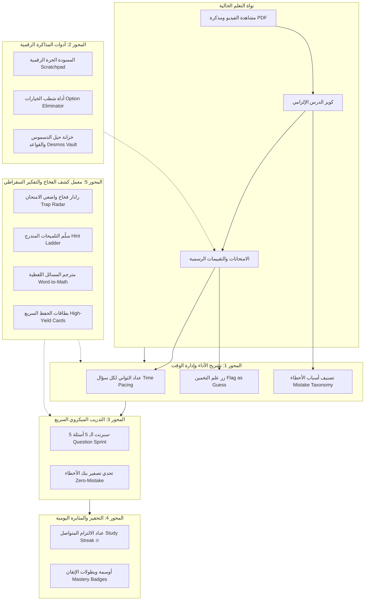

# الخطة الشاملة لتطوير وتوسيع منظومة الطالب (Student Experience Master Plan)
## منصة SaaS التعليمية White-Label للمدرسين — مسار الـ American Curriculum (SAT / EST / ACT)

> **وثيقة معمارية واستراتيجية معتمدة**  
> **الإصدار:** 1.0 · **التاريخ:** أكتوبر 2026  
> **المرجعية المعمارية:** متوافقة 100% مع `docs/canonical/` ومع دستور البرمجة العالمي لمنصة EduSaaS (Clean Architecture · Cubits · Pure Constructor Injection · Zero Localization Debt).

---

## 1. الرؤية الفلسفية والتصميمية لتجربة الطالب

طالب النظام الأمريكي (SAT / EST / ACT) يختلف جذرياً عن طالب التعليم التقليدي القائم على الحفظ. في اختبارات الرياضيات المعيارية:
1. **الوقت هو الخصم الأول:** الطالب يملك في المتوسط **87 ثانية** لكل سؤال في الـ Digital SAT.
2. **الخيارات الخاطئة (Distractors) مصممة هندسياً للإيقاع به:** واضعو الاختبارات في الـ College Board يضعون إجابات الأخطاء الشائعة متعمّدين كخيارات أساسية.
3. **النجاح يتطلب أدوات تفكير وسرعة:** الطالب يحتاج حاسبة رسومية سريعة (Desmos)، مسودة سريعة، ورادار يكشف له أين تهدر ثوانيه، بدلاً من مجرد إخباره "لقد حصلت على 75%".

تحوّل هذه الخطة منصة الطالب من مجرد "مكان لحل الامتحانات ومشاهدة الفيديوهات" إلى **مختبر تدريب رياضي متكامل (Mathematical Athlete Training Hub)**.

---



---

## 2. تفصيل المحاور الخمسة الاستراتيجية

---

### المحور الأول: تشريح أداء الامتحان وإدارة الوقت الذكية (Exam Post-Mortem & Pacing Intelligence)

> **الهدف الأكاديمي:** تحويل نتيجة الامتحان من رقم جامد (مثلاً 680/800) إلى خريطة تشريحية تكشف للطالب كيف أدار وقته وسلوكه الذهني أثناء الحل.

#### 1.1 محلل وقت الأسئلة ورادار السرعة (Time-per-Question Pacing Radar)
* **المشكلة:** يخرج الطالب من الامتحان شاعراً بضيق الوقت في آخر 5 أسئلة، ولا يعرف أي سؤال بالضبط استنزف طاقته ووقته في البداية.
* **الحل المعماري:**
  * إضافة عداد وقت بالثواني غير مرئي لكل سؤال داخل `ExamTakingCubit` يسجل مدة مكوث الطالب في السؤال (`seconds_spent`).
  * في شاشة النتيجة ومراجعة الامتحان (`ExamResultPage` / `ExamReviewPage`)، يُعرض شريط سرعة ملون:
    * 🟢 **Green (< 60s):** حل فائق السرعة وبكفاءة.
    * 🟡 **Yellow (60s - 100s):** النطاق الطبيعي لاختبارات الـ SAT.
    * 🔴 **Red (> 120s):** فخ الوقت (Time Sink).
  * **تنبيه الإدارة الذكية:** تظهر بطاقة ملخصة تقول: *"أهدرت 6 دقائق كاملة على السؤالين رقم 7 و 14، ولو قمت بتخمينهما مبكراً لربحت وقتاً لحل 4 أسئلة أخرى سهلة في نهاية القسم"*.

#### 1.2 زر "تخمين / غير متأكد" أثناء الامتحان (Flag as Guess / Uncertain)
* **المشكلة:** الطالب يخمّن إجابة عشوائية أو غير واثق منها بنسبة 100%، ويصادف أن تكون صحيحة. النتيجة: يتجاوز السؤال دون مراجعته أبداً وتظل الفجوة المفهومية كامنة!
* **الحل المعماري:**
  * زر أيقونة علم/شك 🚩 بجوار رقم السؤال: *"أنا غير واثق / خمنت"*.
  * يحفظ الحالة محلياً في مصفوفة الأسئلة.
  * في شاشة المراجعة، يظهر وسم واضح: 🍀 *"إجابة صحيحة بحالف الحظ (Lucky Guess)"* مع زر فوري: *"أضف هذا السؤال لبنك المراجعة لتثبيت فكرته"*.

#### 1.3 مصفوفة تصنيف سبب الخطأ (Mistake Taxonomy & Reflection Matrix)
* **المشكلة:** في بنك الأخطاء، الطالب يعيد حل السؤال لكنه لا يتعلم "لماذا وقع في الفخ أول مرة".
* **الحل المعماري:**
  * عند فتح أي سؤال خطأ في `StudentMistakesPage`، يظهر شريط وسوم تفاعلي من 4 أسباب مصممة لطلاب الماث الأمريكي:
    1. 🧠 **Concept Gap (فجوة مفهومية):** لم أكن أعلم النظرية أو القانون أصلاً.
    2. ⚡ **Careless Calculation (خطأ حسابي أو إشارة):** أخطأت في إشارة سالب أو جمع أرقام بالرغم من فهمي للطريقة.
    3. 📖 **Misread / Wording Trap (سوء قراءة):** السؤال طلب $3x$ وأنا أوجدت $x$، أو لم أنتبه لكلمة "except".
    4. ⏳ **Time Pressure (ضغط الوقت):** اضطررت للاختيار العشوائي لأن الوقت كان يداهمني.
  * **مؤشر تحليلي للطالب وولي الأمر:** يعرض رسماً بيانياً: *"65% من أخطاء الطالب ناتجة عن التسرع وسوء القراءة، وليس صعوبة المادة العلمية"*.

#### 1.4 تقرير ما بعد الامتحان (Post-Exam Diagnostic Debrief)
* بطاقة ملخصة شاملة في نهاية كل امتحان كبير توضح:
  * توزيع الأسئلة الصائبة/الخاطئة حسب التوبيك (Heart of Algebra / Advanced Math / Problem Solving / Geometry).
  * مقارنة سرعة الحل بالمتوسط العام لطلاب المجموعة.
  * زر مباشر: *"بدء جولة تدريبية مخصصة للأخطاء التي ارتكبتها في هذا الاختبار فوراً"*.

---

### المحور الثاني: أدوات المذاكرة الرقمية التفاعلية داخل الامتحان (In-Exam & Study Tooling Suite)

> **الهدف الأكاديمي:** مطابقة بيئة الامتحان لتطبيق Bluebook الرسمي للـ College Board، وتزويد الطالب بكل ما يحتاجه دون لمس ورقة وقلم خارجية.

#### 2.1 المسودة الرقمية والقلم الحر (Digital Scratchpad & Scribble Canvas)
* **المشكلة:** في امتحانات الماث، يحتاج الطالب لحساب الخطوات أو رسم مثلث أو تقاطع مستقيمين. البحث عن ورقة خارجية يشتت تركيزه، وخاصة على الـ Web والتابلت.
* **الحل المعماري:**
  * زر قلم ✏️ أعلى الشاشة يفتح مساحة رسم خفيفة شفافة (`Interactive Canvas Overlay`) مباشرة فوق شاشة السؤال أو في لوح جانبي قابل للسحب.
  * تدعم القلم (Stylus/Apple Pencil)، اللمس بالإصبع، أو الماوس.
  * خيارات بسيطة وسريعة: قلم، ممحاة، مسح الكل (`Clear All`)، مع بقاء الرسم محفوظاً لكل سؤال إذا رجع إليه الطالب.

#### 2.2 أداة استبعاد الخيارات (Option Eliminator / Cross-Out Engine)
* **المشكلة:** استراتيجية الحل بالاستبعاد (Process of Elimination) هي السلاح الأقوى في الـ SAT. إذا تأكد الطالب أن الخيار (A) و (C) مستحيلان، يريد شطبهما بصرياً ليركز على (B) و (D).
* **الحل المعماري:**
  * زر تفعيل وضع الشطب ✂️: عند الضغط على أي خيار، يتم وضع خط شطب أفقي رمادي خافت عليه (`strikethrough`) مع تخفيف شفافيته، دون اختياره كإجابة نهائية.
  * نقرة ثانية تزيل الشطب، ونقرة على جسم الخيار نفسه تحدده كإجابة رسمية.

#### 2.3 خزانة حيل الدسموس والقواعد السريعة (Teacher's Secret Cheat-Sheet & Desmos Vault)
* **المشكلة:** ينسى الطالب كيفية إدخال نظام معادلات معقد في Desmos أو طريقة إيجاد جذور المعادلة بلمسة واحدة.
* **الحل المعماري:**
  * تبويب مخصص في شريط الطالب الجانبي: **"خزانة الحيل الرياضية (Desmos & Formula Vault)"**.
  * كبسولات فيديو فائقة القصر (60 إلى 120 ثانية) بجودة عالية يرفعها المدرس تشرح حيل الدسموس السريعة:
    * *كيفية حل أنظمة المعادلات الخطية باستخدام دوال التقاطع.*
    * *إيجاد قمة القطع المكافئ (Vertex of Parabola) بالرسم.*
    * *استخدام الجداول (Sliders & Tables) لتجربة الخيارات.*
  * مرفق بجانب كل حيلة مسألة تجريبية سريعة ليطبقها الطالب عملياً على حاسبة Desmos المدمجة في المنصة.

#### 2.4 الحفظ في المفضلة والملاحظات الشخصية (Smart Bookmarks & Student Margin Notes)
* إمكانية وضع علامة ⭐ على أي سؤال ذي فكرة ذكية أثناء الكويزات أو الامتحانات أو بنك الأسئلة.
* إضافة حقل ملاحظة نصية خاصة بالطالب: *"سؤال رائع لفكاهة الخدعة في نصف القطر، أراجعه قبل امتحان أكتوبر"*.
* قسم مخصص: **"أسئلتي المفضلة"** لمراجعتها بضغطة زر.

---

### المحور الثالث: التدريب الميكروي وتحدي تصفير الأخطاء (Targeted Rapid Micro-Drills & Gauntlet)

> **الهدف الأكاديمي:** القضاء على الرهبة من الجلسات الدراسية الطويلة وتحويل المذاكرة إلى جرعات صغيرة متكررة وسريعة الهضم.

#### 3.1 جلسات السبرنت السريعة (5-Question Sprint / Flash Practice)
* **المشكلة:** ليس لدى الطالب دائماً 60 دقيقة لحل اختبار كامل. في كثير من الأوقات لديه 10 دقائق في استراحة أو في السيارة يريد استغلالها.
* **الحل المعماري:**
  * زر **"سبرنت سريع (Quick 5-Question Sprint)"** في الصفحة الرئيسية.
  * يختار الطالب الموضوع (مثل: `Exponents & Radicals` أو `Quadratic Equations`).
  * يتم سحب 5 أسئلة عشوائية من بنك الأسئلة الخاص بمستواه، بمؤقت تنازلي (7 دقائق مثلاً).
  * تصحيح فوري بعد نهاية السبرنت يعطيه دفعة معنوية سريعة.

#### 3.2 تحدي تصفير بنك الأخطاء (Zero-Mistake Gauntlet)
* **المشكلة:** تراكم الأسئلة الخاطئة في بنك الأخطاء دون دافع لتصفيتها.
* **الحل المعماري:**
  * شريط تقدم دائري أو أفقي في أعلى صفحة بنك الأخطاء:
    * *"متبقي لديك 18 خطأ في بنكك. هل تقبل تحدي تصفير الأخطاء اليوم؟"*
  * زر **"بدء التحدي (Start Gauntlet)"**: يبدأ جولة مخصصة تعرض الأسئلة الأكثر رسوباً وتكراراً (`High Failure Count`).
  * عند الإجابة الصحيحة على السؤال، ينتقل تلقائياً لحالة `Resolved` ويتحرك المؤشر نحو الصفر مع تأثير احتفالي بصري خفيف وراقٍ.

#### 3.3 فلترة وتصنيف الأخطاء الذكي (Smart Mistake Filtering & Sorting)
* إمكانية تصنيف الأسئلة داخل بنك الأخطاء حسب:
  * مصدر الخطأ (امتحان شامل / كويز درس / واجب منزلي).
  * سبب الخطأ (Concept vs Careless vs Misread).
  * الموضوع العلمي (Heart of Algebra, Passport to Advanced Math, etc.).

#### 3.4 وضع إعادة المحاولة المطور (Smart Retake with Shuffled Options)
* عند إعادة حل السؤال الخاطئ، يتم خلط ترتيب الخيارات عشوائياً (Shuffle Distractors) لمنع الطالب من تذكر موقع الحرف (مثل "كانت C في المرة السابقة") وإجباره على التفكير الحقيقي.

---

### المحور الرابع: سيكولوجية التحفيز وعادات الالتزام (Academic Momentum, Streaks & Gamified Consistency)

> **الهدف الأكاديمي:** خلق التزام يومي مستدام دون الاعتماد فقط على الإجبار، بل على حب التقدم والشعور بالإنجاز اليومي.

#### 4.1 عداد الالتزام اليومي المتواصل (Study Streak Counter 🔥)
* **المشكلة:** الطالب يذاكر بكثافة ليلة الامتحان ثم ينقطع أسبوعين. اختبارات الـ SAT تتطلب لياقة ذهنية يومية (Muscle Memory).
* **الحل المعماري:**
  * عداد ذكي أعلى لوحة التحكم: `🔥 4 Days Streak`.
  * يحتسب اليوم نشطاً إذا قام الطالب بأي نشاط معنوي مسجل في الـ Activity Whitelist (مشاهدة فيديو، تسليم واجب، حل كويز، أو إكمال سبرنت أخطاء).
  * رسائل تحفيزية خفيفة: *"رائع يا بطل! حافظت على لياقتك الرياضية 5 أيام على التوالي"*.

#### 4.2 أوسمة الإنجاز الأكاديمية (Mastery & Mathematical Milestones Badges)
* أوسمة استحقاق رياضية مستوحاة من رموز الرياضيات والتميز الأكاديمي، تُمنح تلقائياً عند تحقيق أهداف نوعية:
  * 📐 **Desmos Sorcerer:** استخدام حاسبة دسموس وحل 25 مسألة بنجاح.
  * 🎯 **Sniper:** إنهاء كويز كامل بدرجة 100% في أقل من 5 دقائق.
  * 🛡️ **Zero Mistake Slayer:** تصفير 20 سؤالاً من بنك الأخطاء بنجاح.
  * 👑 **Century Club:** إكمال 100 مسألة محلولة داخل المنصة.
* تعرض الأوسمة في صفحة الملف الشخصي للطالب كلوحة شرف شخصية محفزة.

#### 4.3 ملخص الإنجاز الأسبوعي (Weekly Student Progress Digest)
* بطاقة ملخصة تظهر للطالب كل يوم أحد توضح:
  * عدد الساعات التي قضاها في التدريب.
  * عدد الأسئلة التي حلها، ونسبة الدقة الإجمالية.
  * مقارنة أدائه بالأسبوع السابق: *"ارتفعت سرعتك في الحل هذا الأسبوع بنسبة 14%"*.

#### 4.4 نظام المستويات الرياضي (Mathematical Progression Levels)
* تقدم رتبي تدريجي يتغير بناءً على نقاط الخبرة المكتسبة من إكمال الدروس وحل المسائل:
  * Level 1: `Apprentice` (المبتدئ الواعد)
  * Level 2: `Problem Solver` (مفكك المسائل)
  * Level 3: `Strategist` (خبير الاستراتيجيات)
  * Level 4: `Math Wizard` (ساحر الرياضيات)

---

### المحور الخامس (المبتكر والعبقري): معمل كشف الفخاخ والتفكير السقراطي (Trap Radar & Socratic Deconstruction Lab)

> **الفكرة العبقرية:** الفارق بين الطالب الذي يحصل على 600 في الماث والطالب الذي يحصل على 800 ليس فقط حفظ القوانين، بل قدرته على **"التفكير مثل واضع الامتحان"** والتنبؤ بالفخ قبل السقوط فيه، والحصول على التوجيه دون كشف الحل مباشرة.

```
                           [سؤال صعب يواجه الطالب]
                                      │
         ┌────────────────────────────┴────────────────────────────┐
         ▼                                                         ▼
[معمل الفخاخ Trap Radar]                                [سلّم التلميحات Socratic Ladder]
"لماذا وضع واضع الامتحان الخيار B؟"                  "Hint 1: تذكير بالقاعدة المفهومية"
"لأنه يعلم أنك ستنسى ضرب الطرفين في 2!"               "Hint 2: خطوة البداية في المعادلة"
                                                     "Hint 3: استراتيجية الحل عبر Desmos"
```

#### 5.1 رادار كشف فخاخ واضعي الامتحان (Distractor Trap Radar: "لماذا هذا الخيار موجود؟")
* **العمق الفلسفي:** في اختبارات الـ SAT، الخيارات (A, B, C, D) لم توضع اعتباطاً؛ كل خيار خاطئ هو نتيجة خطأ منطقي شهير يقوم به آلاف الطلاب.
* **كيف تعمل الميزة؟**
  * عند مراجعة السؤال في بنك الأخطاء أو بعد نهاية الاختبار، يمكن للطالب تفعيل زر: **"رادار الفخاخ (Trap Analysis)"**.
  * يظهر شرح دقيق تحت كل خيار خاطئ:
    * **الخيار A (إجابة خاطئة):** *"هذا هو فخ التسرع! يعطيك قيمة $x$، بينما السؤال طلب قيمة $2x - 5$"*.
    * **الخيار B (إجابة خاطئة):** *"هذا فخ نسيان الإشارة السالبة عند فك الأقواس"*.
    * **الخيار C (الإجابة الصحيحة):** *"الحل السليم بعد ضرب المعادلة في المرافق"*.
  * **الأثر على عقل الطالب:** يتعلم الطالب ألا يختار الإجابة فقط لأنها "ظهرت معه على الآلة الحاسبة"، بل يتأكد أولاً أنها ليست فخاً منصوباً له!

#### 5.2 سلّم التلميحات المتدرج في التدريب الموجه (Socratic Hint Ladder)
* **المشكلة:** عندما يعجز الطالب عن حل مسألة في تدريب الأخطاء، يكون أمامه خياران سيئان: إما الاستسلام، أو رؤية الحل الكامل فتنعدم الفائدة الذهنية.
* **الحل المعماري:**
  * زر **"تلميح سقراطي (Need a Hint?)"** يقدم مساعدة متدرجة على 3 مستويات:
    * 💡 **Level 1 (Concept Hint - المفهوم):** *"المسألة تتطلب إيجاد المسافة بين نقطتين. تذكر أن صيغة المسافة مستمدة من نظرية فيثاغورس"*.
    * 🔍 **Level 2 (First Step Hint - خطوة البداية):** *"ضع المعادلة بالصورة القياسية $(x - h)^2 + (y - k)^2 = r^2$ عن طريق إكمال المربع لمجاهيل $x$ ومجاهيل $y$"*.
    * ⚡ **Level 3 (Desmos Shortcut Hint - حيلة الحل السريع):** *"يمكنك حل هذه المسألة في 15 ثانية على Desmos بكتابة المعادلة الأصلية، ثم استخدام أداة السلايدر لمطابقة الخيارات"*.
  * يدرب الطالب على التدرج في التفكير وبناء ثقته بنفسه.

#### 5.3 المترجم الرياضي للمسائل اللفظية (Word-to-Math Equation Translator)
* **المشكلة:** معظم طلاب المدارس الدولية والعرب يكرهون المسائل اللفظية الطويلة (Word Problems) المليئة بالسياقات مثل الشركات، التكلفة، ومعدلات التدفق، ويجدون صعوبة في تحويل الكلام الإنجليزي لمعادلة.
* **الحل المعماري:**
  * أداة تفاعلية مدمجة تسلط الضوء على الكلمات المفتاحية في نص السؤال (Keywords Highlighter):
    * *"is / was / results in"* → تُترجم تلقائياً إلى `$=$`
    * *"per / each / for every"* → تُترجم تلقائياً إلى معدل التغير أو الميل `$m$`
    * *"initial / starting value / fixed fee"* → تُترجم تلقائياً إلى الجزء المقطوع `$b$`
  * توضح للطالب كيف تحولت الجملة الطويلة السخيفة إلى معادلة خطية بسيطة من الدرجة الأولى $y = mx + b$.

#### 5.4 بطاقات الحفظ والمراجعة المركزة ليلة الامتحان (High-Yield SAT Formula Flashcards)
* مكتبة رقمية أنيقة تضم أهم **30 بطاقة ذهبية** للقوانين والعلاقات الرياضية التي تتكرر في 90% من امتحانات SAT / EST:
  * قوانين القطع المكافئ والرأس $x = -b / (2a)$.
  * متطابقات حساب المثلثات الأساسية $\sin(x) = \cos(90^\circ - x)$.
  * قوانين الدوائر والأقواس بالراديان والدرجات $s = r\theta$.
  * قوانين الأسس والجذور والدوال الأسية للنمو والاضمحلال $A = P(1 \pm r)^t$.
* البطاقة بنظام الوجهين (Flip Card): الوجه الأول السؤال/القانون الناقص، والوجه الثاني الصيغة مع مثال تطبيقي من سؤال حقيقي.

---

## 3. المواصفات التقنية والمعمارية لتنفيذ الخطة (Technical & Architectural Blueprint)

تلتزم جميع هذه الإضافات بقواعد المشروع الدستورية الصارمة:

```
┌────────────────────────────────────────────────────────┐
│ UI Layer (Widgets < 150 lines, Zero Localization Debt)  │
└───────────────────────────┬────────────────────────────┘
                            │
┌───────────────────────────▼────────────────────────────┐
│ Presentation: Pure Cubits (e.g., PacingCubit, HintsCubit)│
└───────────────────────────┬────────────────────────────┘
                            │
┌───────────────────────────▼────────────────────────────┐
│ Domain: Entities & Pure UseCases (Immutable Snapshots) │
└───────────────────────────┬────────────────────────────┘
                            │
┌───────────────────────────▼────────────────────────────┐
│ Data: Repositories & Local Scratchpad Storage (Cache)  │
└───────────────────────────┬────────────────────────────┘
                            │
┌───────────────────────────▼────────────────────────────┐
│ Backend: Supabase Postgres + RLS (No Untrusted Inputs) │
└────────────────────────────────────────────────────────┘
```

### 1. إدارة الحالة (State Management)
* الالتزام الصارم بـ **Cubit** فقط (`flutter_bloc`).
* كل ميزة جديدة تملك Cubit مخصص وصغير الحجم، مثل:
  * `ExamPacingCubit`: يدير توقيت الأسئلة وتخزين الثواني لكل سؤال محلياً.
  * `ScratchpadCubit`: يدير نقاط الرسم على الـ Canvas ومسحها.
  * `SocraticHintCubit`: يدير فتح مستويات التلميحات المتدرجة.
  * `StudentStreakCubit`: يدير جلب وتحديث عداد الـ Streak اليومي.

### 2. معايير الكود ونظافة الملفات (Anti-Monolith & DoD)
* لا يوجد ملف يتجاوز **150–200 سطر** من الكود.
* تقسيم المكونات إلى ويدجتس معزولة تماماً داخل مجلدات الميزات المعنية (`presentation/widgets/`).
* **Zero Localization Debt:** كل نص، تسمية، رسالة، أو تلميح يُضاف فوراً في `app_en.arb` و `app_ar.arb` بنسبة تطابق 100% مع تشغيل `flutter gen-l10n`.
* استهلاك الألوان حصرياً من Tokens نظام التصميم (`Theme.of(context).colorScheme` و `AppColors`).

---

## 4. جدول مراحل التنفيذ والتسليم (Phased Roadmap)

| المرحلة | المحور / الميزة | الهدف الأساسي | المدة التقديرية |
|:---:|---|---|:---:|
| **المرحلة 1 (P1)** | **تصنيف أسباب الأخطاء + أداة شطب الخيارات** | تفعيل `Mistake Taxonomy` في بنك الأخطاء وأداة `Option Eliminator` في الامتحانات | 3 إلى 4 أيام |
| **المرحلة 2 (P2)** | **عداد وقت السؤال ورادار السرعة + علم التخمين** | تتبع أزمنة الأسئلة وإظهار رسم بياني تفاعلي لإدارة الوقت بعد تسليم الامتحان | 4 إلى 5 أيام |
| **المرحلة 3 (P3)** | **المسودة الرقمية (Scratchpad Canvas) + خزانة حيل الدسموس** | تمكين الطالب من الرسم المباشر أثناء الحل ومكتبة فيديوهات الحيل السريعة | 5 أيام |
| **المرحلة 4 (P4)** | **معمل الفخاخ (Trap Radar) + سلّم التلميحات السقراطي** | تقديم شروحات الخيارات الخاطئة والتلميحات المتدرجة في بنك التدريب | 5 إلى 6 أيام |
| **المرحلة 5 (P5)** | **سبرنت الـ 5 أسئلة السريع + عداد الـ Streak اليومي والأوسمة** | تعزيز عادة المذاكرة اليومية والتدريب السريع المصغر | 4 إلى 5 أيام |

---

## 5. مخرجات القيمة التنافسية (Competitive Edge)

بتطبيق هذه الخطة:
1. **للطالب:** يتحول التعلم من عبء إلى لعبة احترافية ذكية تمكنه من رفع درجته في الـ SAT بمقدار 100 إلى 150 درجة عبر تفادي الفخاخ وحسن إدارة الوقت.
2. **للمدرس (صاحب الـ Tenant):** يملك منصة لا تملكها أي منصة تعليمية أخرى في الشرق الأوسط، تضاهي كبرى منصات الاختبارات العالمية مثل UWorld و Khan Academy و Bluebook.
3. **لولي الأمر:** تقارير مفهومة توضح بالضبط أسباب تعثر ابنه (تسرع، ضيق وقت، أم فجوة فهم) مما يمنع النزاعات الأسرية ويوجه الجهد للحل العملي.
