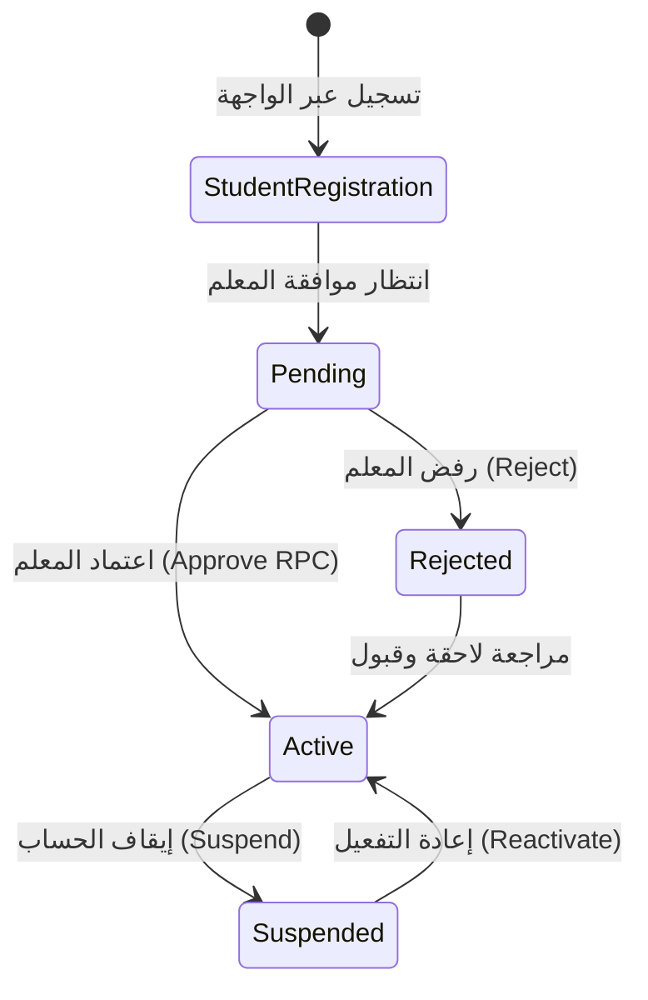
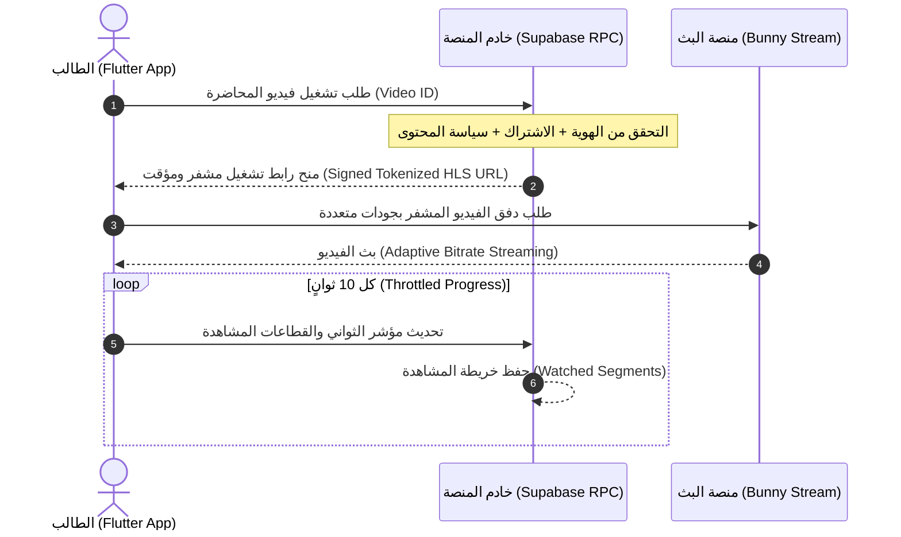
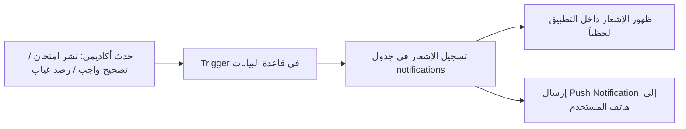

# دليل المنصة الشامل والمفصل: منصة EduSaaS (EdSentre)
## المنصة التعليمية السحابية المتكاملة للمدرسين المستقلين بنموذج White-Label
### الدليل المرجعي الكامل للمنظومة: الرؤية، المعمارية، الميزات، الأمان، وتدفقات العمل

---

> **بيانات التوثيق المرجعي:**
> - **اسم المنصة البرمجي:** EduSaaS / EdSentre Engine
> - **الإصدار الأساسي:** Production V1.0 (معتمد أمنياً ومعمارياً بنسبة 100%)
> - **النموذج التقني:** Multi-Tenant White-Label Academic SaaS
> - **العميل الرائد الأول (Flagship Tenant):** د. أنطونيوس أشرف (Dr. Antounios Ashraf) — متخصص الدبلومة الأمريكية (SAT / EST / ACT)
> - **الحالة التشغيلية:** جاهز للإنتاج (Production Ready) ومجتاز لمصفوفة اختبارات الاختراق الأمني الـ 11 بنسبة 100%.

---

## فهرس المحتويات التنفيذي
1. [الرؤية العامة وفلسفة المنصة](#1-الرؤية-العامة-وفلسفة-المنصة)
2. [الهيكل المعماري والتقني (The Architectural Stack)](#2-الهيكل-المعماري-والتقني-the-architectural-stack)
3. [مصفوفة الأدوار والصلاحيات (RBAC Matrix)](#3-مصفوفة-الأدوار-والصلاحيات-rbac-matrix)
4. [إدارة المستأجرين، الطلاب، والمجموعات (Tenants, Students & Groups)](#4-إدارة-المستأجرين-الطلاب-والمجموعات-tenants-students--groups)
5. [منظومة الكورسات والمحاضرات والتعلم المتسلسل (Courses & Sequential Learning)](#5-منظومة-الكورسات-والمحاضرات-والتعلم-المتسلسل-courses--sequential-learning)
6. [منظومة الفيديو المشفر الآمن وتتبع المشاهدة (Protected Video Engine)](#6-منظومة-الفيديو-المشفر-الآمن-وتتبع-المشاهدة-protected-video-engine)
7. [ترسانة الامتحانات والتصحيح الذري (Exams Engine & Versioning)](#7-ترسانة-الامتحانات-والتصحيح-الذري-exams-engine--versioning)
8. [امتحانات الـ PDF المرفق ومحاكي الـ Bluebook المزدوج (Split-Screen Exams)](#8-امتحانات-الـ-pdf-المرفق-ومحاكي-الـ-bluebook-المزدوج-split-screen-exams)
9. [بنك الأسئلة المركزي والتصنيف الهرمي (Central Question Bank)](#9-بنك-الأسئلة-المركزي-والتصنيف-الهرمي-central-question-bank)
10. [ترسانة الطالب الأكاديمية (Student Super-Arsenal: Anki, Vault & Pacing)](#10-ترسانة-الطالب-الأكاديمية-student-super-arsenal-anki-vault--pacing)
11. [منظومة الواجبات والتقييم (Assignments & Qualitative Feedback)](#11-منظومة-الواجبات-والتقييم-assignments--qualitative-feedback)
12. [منظومة الحضور والانضباط الأكاديمي (Attendance & Engagement Index)](#12-منظومة-الحضور-والانضباط-الأكاديمي-attendance--engagement-index)
13. [التحليلات، ملف الطالب 360°، ورادار المدرس الذكي (Analytics & Radar Alerts)](#13-التحليلات-ملف-الطالب-360-ورادار-المدرس-الذكي-analytics--radar-alerts)
14. [محرك الإشعارات والتواصل الأكاديمي التلقائي (Academic Notifications Engine)](#14-محرك-الإشعارات-والتواصل-الأكاديمي-التلقائي-academic-notifications-engine)
15. [الأمان السيبراني، حماية البيانات، وخصوصية القُصَّر (Cybersecurity & Zero-Trust)](#15-الأمان-السيبراني-حماية-البيانات-وخصوصية-القُصَّر-cybersecurity--zero-trust)
16. [نظام التصميم، الواجهات، والتعريب الفوري (Design System & Localization)](#16-نظام-التصميم-الواجهات-والتعريب-الفوري-design-system--localization)
17. [كتالوج الشاشات الكامل وتدفقات المستخدمين (57+ Complete Screen Catalog)](#17-كتالوج-الشاشات-الكامل-وتدفقات-المستخدمين-57-complete-screen-catalog)
18. [معايير الجودة والـ Definition of Done (DoD)](#18-معايير-الجودة-والـ-definition-of-done-dod)
19. [خارطة الطريق المستقبلية والتوسعات القادمة (Roadmap V1.1 / V2)](#19-خارطة-الطريق-المستقبلية-والتوسعات-القادمة-roadmap-v11--v2)

---

## 1. الرؤية العامة وفلسفة المنصة

### 1.1 ما هي منصة EduSaaS؟
منصة **EduSaaS (EdSentre)** هي منصة برمجية تعليمية متكاملة كخدمة (**White-Label Multi-Tenant SaaS**) تم بناؤها وتصميمها هندسياً لتمكين المدرسين المستقلين والمؤسسات الأكاديمية من امتلاك أكاديميتهم الرقمية الخاصة بالكامل، تحت هويتهم التجارية ودومينهم المستقل، دون مشاركة بياناتهم مع أي مدرس آخر أو الخضوع لقيود منصات التعليم الجماعية المشتركة.

بدلاً من إدارة المعلم لطلابه وتدريسه عبر أدوات مشتتة وغير آمنة (مثل جروبات واتساب، وجداول إكسل، ومجلدات جوجل درايف غير المحمية، وامتحانات ورقية تفقد تحليلاتها)، توفر EduSaaS بيئة أكاديمية متكاملة تدار بدقة متناهية تشمل:
- بث الفيديوهات المشفرة مع منع التحميل.
- محاكي امتحانات رقمي عالمي يطابق أنظمة القياس الدولية (College Board Digital SAT).
- بنك أسئلة مركزي يدعم المعادلات الرياضية ورسوم الهندسة.
- إدارة الواجبات وتصحيحها بملاحظات توجيهية.
- تسجيل الحضور والغياب مع احتساب مؤشرات الانضباط.
- بوابة شفافة لأولياء الأمور تتيح متابعة الأبناء لحظياً.
- رادار ذكي للمعلم ينبهه بالطلاب المتعثرين أو المعرضين لخطر الهبوط الأكاديمي.

### 1.2 المستأجر الرائد الأول: د. أنطونيوس أشرف (American Diploma Specialist)
تم إطلاق الإصدار الأول V1 كنموذج رائد لمنصة المدرس **د. أنطونيوس أشرف** (متخصص رياضيات الدبلومة الأمريكية لاختبارات **SAT**, **EST**, **ACT**). 
الفلسفة الأكاديمية المنعكسة في المنظومة هي:
$$\text{Concept} + \text{Question Type} + \text{Speed} + \text{Strategy} + \text{Accuracy} = \mathbf{\text{Target 800}}$$

لذلك، تم ضبط تجربة المستخدم لتكون بمثابة **"مختبر تدريب رياضي متقدم (Mathematical Athlete Training Hub)"** وليس مجرد موقع لتصفح الفيديوهات.

---

## 2. الهيكل المعماري والتقني (The Architectural Stack)

تم اختيار بنية النظام بعناية هندسية فائقة لتوفير أعلى درجات الأمان، والأداء فائق السرعة، والتحمل التشغيلي العالي دون تكاليف خوادم باهظة أو تعقيدات DevOps لا طائل منها:

```
┌─────────────────────────────────────────────────────────────────────────────────────────┐
│                                  PRESENTATION LAYER                                     │
│                     Flutter Multi-Platform (Web + Android + iOS)                        │
│   • BLoC / Cubit Pattern (Zero Riverpod)         • Pure Constructor Injection (No DI)   │
│   • GoRouter Declarative Routing (3 Shells)      • Mathematical Design System (Tokens)  │
│   • Zero Localization Debt (100% ARB Sync)       • Responsive Master Engine             │
└─────────────────────────────────────────┬───────────────────────────────────────────────┘
                                          │ Encrypted HTTPS / TLS 1.3
                                          ▼
┌─────────────────────────────────────────────────────────────────────────────────────────┐
│                                BACKEND & DATABASE LAYER                                 │
│                               Supabase (PostgreSQL 15+)                                 │
│   • PostgreSQL RLS (Row Level Security)          • 102 Database Migrations              │
│   • Supabase Auth (JWT & Secure Sessions)       • Supabase Private Buckets             │
│   • PostgreSQL Stored Procedures (Atomic RPCs)   • Edge Functions & Webhooks            │
└──────────────────┬──────────────────────┬───────────────────────┬───────────────────────┘
                   │                      │                       │
                   ▼                      ▼                       ▼
       ┌──────────────────────┐ ┌───────────────────┐ ┌─────────────────────────┐
       │   BUNNY STREAM CDN   │ │  CLOUDFLARE PAGES │ │   FIREBASE FCM CLOUD    │
       │ Video Transcoding    │ │ Global Edge CDN   │ │ Realtime Push Messages  │
       │ DRM Token Signing    │ │ Zero-Downtime Host│ │ Academic Notifications  │
       │ HLS Adaptive Playback│ │ Fast Web Delivery │ │ Multi-Device Delivery   │
       └──────────────────────┘ └───────────────────┘ └─────────────────────────┘
```

### تفصيل طبقات الستاك المعتمد:
1. **الواجهة الأمامية (Frontend):**
   - **Flutter (Stable):** واجهة موحدة للويب والهواتف الذكية.
   - **إدارة الحالة (State Management):** حزم `flutter_bloc` بنمط **Cubit فقط** (ممنوع أي State Manager آخر).
   - **حقن التبعيات (Dependency Injection):** نمط **Pure Constructor Injection** و Composition Root، مما يمنح استقلالية واضحة واختبارات نقية دون الحاجة لحاويات عالمية مثل `get_it`.
   - **التوجيه (Routing):** حزمة `go_router` بنظام الـ Shell Routes المنفصلة كلياً لكل دور (`TeacherShell`, `StudentShell`, `ParentShell`).
   - **التعريب (Localization):** دعم RTL و LTR متزامن 100% عبر ملفات ARB الرسمية مع قاعدة دستورية صارمة: **"Zero Localization Debt"** (ممنوع وجود أي كلمة Hardcoded).

2. **الخلفية وقاعدة البيانات (Backend & Database):**
   - **Supabase Cloud / PostgreSQL 15+:** محرك علائقي ضخم يضم أكثر من 102 ملف تهجير (Migrations).
   - **الأمان على مستوى السطر (Row Level Security - RLS):** عزل المستأجرين والبيانات مفروض فيزيائياً داخل محرك قاعدة البيانات، بحيث لا يمكن لأي مستخدم (مهما بلغت مهارته في استدعاء الـ APIs) قراءة أي سطر غير مصرح له به.
   - **المعالجة الذرية (Atomic RPCs):** العمليات الحساسة (تسليم الامتحانات، اعتماد الطلاب، حساب الدرجات، تفويض الفيديو) تنفذ كـ PostgreSQL Transactions داخل قاعدة البيانات أو Edge Functions ولا يسمح للواجهة بحسابها.

3. **الفيديو والوسائط (Media & Video Streaming):**
   - **Bunny Stream:** خدمة متخصصة لمعالجة وبث الفيديو بتقنية التقطيع المتكيف (HLS Transcoding) مع روابط زمنية مشفرة بـ Tokens وموقعة تشفيرياً (Signed URLs)، تمنع التحميل المباشر وتمنع مشاركة الروابط.

4. **الاستضافة والإشعارات:**
   - **Cloudflare Pages:** استضافة نسخة الويب على شبكة حافة عالمية فائقة السرعة مع حماية ضد هجمات DDoS.
   - **Firebase Cloud Messaging (FCM):** جسر إرسال الإشعارات اللحظية للهواتف والويب.

---

## 3. مصفوفة الأدوار والصلاحيات (RBAC Matrix)

المنصة تعتمد مبدأ **"Zero Trust in Flutter Client"**؛ الواجهة تحدد فقط ما يظهر للمستخدم لتسهيل التصفح، بينما تفرض قاعدة البيانات عبر RLS والـ Functions الصلاحيات الحقيقية:

| المورد الأكاديمي | المعلم (Teacher) | الطالب (Student) | ولي الأمر (Parent) | آلية فرض الصلاحية |
|---|:---:|:---:|:---:|---|
| **بيانات المستخدم الشخصية** | قراءة وتعديل | قراءة وتعديل محدود | قراءة وتعديل محدود | `users.id = auth.uid()` |
| **قائمة الطلاب والملفات** | إدارة كاملة (CRUD) | قراءة بياناته فقط | قراءة بيانات أبنائه فقط | فحص الـ Tenant أو جدول `parent_students` |
| **المجموعات (Groups)** | إدارة كاملة (CRUD) | قراءة عضوياته فقط | قراءة مجموعات الأبناء | جدول `group_members` |
| **المحتوى والكورسات** | إدارة كاملة + مسودات | المنشور والمصرح به فقط | المصرح به للأبناء | شرط `status = 'published'` + فحص العضوية |
| **الفيديوهات والمحاضرات** | رفع وإدارة كاملة | تشغيل مفوض ومؤقت | نسب الإكمال فقط | RPC `authorize_video_playback` |
| **الواجبات والتسليمات** | إنشاء ومراجعة وتقييم | قراءة وتسليم واجباته | قراءة حالة تسليم الأبناء | RLS + التحقق من مالك التسليم |
| **الامتحانات والأسئلة** | إنشاء وإصدارات وبنك أسئلة | أداء وعرض النتيجة | عرض النتائج والتقارير | RPC `start_exam` + `submit_exam` |
| **إجابات الامتحان الصحيحة (`is_correct`)** | قراءة وتعديل | **محظور كلياً** أثناء الأداء | **محظور كلياً** | لا يتم إرسال الحقل أبداً للعميل |
| **تسجيل الحضور** | رصد وتعديل يومي | قراءة سجلاته فقط | قراءة سجلات الأبناء | RLS مقيدة بـ `group_id` |
| **سجل المراجعة والتدقيق (Audit Logs)** | قراءة مقيدة لأحداثه | **محظور كلياً** | **محظور كلياً** | الكتابة مقتصرة على دوال الـ Database |

---

## 4. إدارة المستأجرين، الطلاب، والمجموعات (Tenants, Students & Groups)



### 4.1 دورة حياة حساب الطالب (Student Account Lifecycle)
1. **التسجيل الذاتي (Self-Registration):** يسجل الطالب عبر إدخال الاسم، البريد الإلكتروني، كلمة المرور، رقم الهاتف، ورقم هاتف ولي الأمر.
2. **حالة الانتظار (`pending`):** ينتقل الطالب فوراً لشاشة انتظار ولا يرى أي محتوى أكاديمي أو مجموعات.
3. **مراجعة المعلم (Teacher Review):** يظهر طلب التسجيل في شاشة طلبات المعلم مع إشعار فوري. يمتلك المعلم خيار الاعتماد (`Approve`) أو الرفض (`Reject`).
4. **التفعيل والتدقيق (Audit Log):** عند الاعتماد عبر دالة `approve_student`، يتم تسجيل العملية في الـ Audit Log، ويتحول الحساب إلى `active`، ويصل الطالب إشعار تهنئة.
5. **التعليق (`suspended`):** في حال تعثر الطالب أو مخالفته، يمكن للمعلم إيقافه مؤقتاً دون حذف بياناته الأكاديمية إطلاقاً.

### 4.2 المجموعات وسياسة المحتوى السابق (Groups & Previous Content Policy)
- **علاقة Many-to-Many:** يمكن للطالب الانتماء لأكثر من مجموعة في نفس الوقت (مثلاً: مجموعة `SAT Basics` ومجموعة `EST Level 2`).
- **فصل الاعتماد عن التوزيع:** قبول الطالب في المنصة لا يضمه تلقائياً لمجموعة؛ تحديد المجموعات قرار مستقل للمعلم.
- **سياسة المحتوى السابق (`previous_content_access`):** 
  - في كل مجموعة يحدد المعلم: هل يرى الطالب الجديد الدروس المنشورة قبل تاريخ انضمامه (`allow`)، أم يبدأ فقط من المحتوى المنشور بعد تاريخ إضافته للمجموعة (`deny`).
  - يتم فرض هذه السياسة في قاعدة البيانات بمقارنة `group_members.joined_at` مع `content.published_at`.

---

## 5. منظومة الكورسات والمحاضرات والتعلم المتسلسل (Courses & Sequential Learning)

```
الكورس الأكاديمي (Course)
  │
  ├── الفصل الأول (Chapter 1: Heart of Algebra)
  │     ├── المحاضرة 1.1: Linear Equations & Systems
  │     │     ├── فيديو الشرح المتقدم (Bunny Stream HLS)
  │     │     ├── مذكرة المحاضرة وتلخيص القوانين (Attached PDF)
  │     │     ├── كويز استيعابي فوري (Mandatory Quiz)
  │     │     └── واجب المحاضرة وتطبيقات المسائل (Assignment)
  │     │
  │     └── المحاضرة 1.2: Inequalities & Absolute Value (مقفولة حتى إنهاء 1.1)
  │
  └── الفصل الثاني (Chapter 2: Advanced Math & Quadratics)
```

### مميزات المنظومة:
- **الهيكلة الثلاثية الأكاديمية:** تنظيم المحتوى في صورة (Course -> Chapters -> Lessons / Lectures).
- **التعلم المتسلسل الإلزامي (Sequential Gating):** إمكانية قفل المحاضرات المتقدمة حتى يُتم الطالب مشاهدة المحاضرة السابقة بنسبة محددة ويجتاز اختبارها القصير.
- **تخصيص المحتوى للمجموعات (Group Visibility Customization):** إمكانية إظهار محاضرات معينة لمجموعة الـ SAT المتقدمة وإخفائها عن مجموعة التأسيس داخل نفس الكورس.
- **المكتبة الإثرائية للمعلم (Teacher Materials Library):** رفع وتخزين المستندات، أوراق العمل، وقوالب المسائل وإعادة ربطها بأي محاضرة بنقرة زر واحدة دون الحاجة لإعادة رفع الملف.

---

## 6. منظومة الفيديو المشفر الآمن وتتبع المشاهدة (Protected Video Engine)



### الخصائص الهندسية لمنظومة الفيديو:
1. **الرفع المباشر الذكي (Direct-to-Bunny Upload):** يقوم المعلم باختيار ملف الفيديو، فيقوم التطبيق بطلب إذن رفع مؤقت والرفع مباشرة إلى Bunny Stream دون إرهاق خوادم قاعدة البيانات.
2. **الترميز المتعدد الآلي (Automatic Transcoding):** بمجرد اكتمال الرفع، تقوم خوادم Bunny بتحويل الفيديو لجودات متعددة تلقائياً (`1080p`, `720p`, `480p`, `360p`) وتجهيز دفق HLS.
3. **تحديث الحالة عبر Webhooks:** عند اكتمال المعالجة يرسل Bunny إشارة Webhook لتتحول حالة الفيديو في قاعدة البيانات من `processing` إلى `ready`. لا يسمح بنشر أي محاضرة قبل وصول حالة الفيديو إلى `ready`.
4. **حماية الروابط ومنع التحميل (Link Tokenization):** لا يوجد رابط فيديو دائم في التطبيق؛ كل عملية تشغيل تتطلب استدعاء دالة `authorize_video_playback` التي تولد توكن زمني ينتهي خلال فترة قصيرة، مما يجعل نسخ الرابط أو مشاركته مع أطراف أخرى بلا قيمة.
5. **خريطة القطاعات المشاهدة والاستئناف (Watched Segments & Resume):**
   - يسجل النظام بالضبط الأجزاء التي شاهدها الطالب بالثواني لمنع تخطي الفيديو دون مشاهدة حقيقية.
   - عند إعادة فتح المحاضرة، يستأنف المشغل تلقائياً من آخر ثانية توقف عندها الطالب بدقة (`Resume Playback`).

---

## 7. ترسانة الامتحانات والتصحيح الذري (Exams Engine & Versioning)

منظومة الامتحانات تمثل جوهر المنصة التعليمية لطلاب النظام الأمريكي، وصممت لتكون مضادة للغش والتلاعب البرمجي والتزامن العشوائي:

### 7.1 تجميد النسخ المنشورة (Exam Snapshots & Versioning)
- **قاعدة الأمان الأكاديمي:** أي امتحان يتم نشره للطلاب يتحول فوراً إلى **نسخة مجمدة (Immutable Snapshot)** في جدول `exam_versions`.
- إذا قرر المعلم تعديل سؤال أو تصحيح خيار لاحقاً، فإن تعديله لا يؤثر بأثر رجعي على الطلاب الذين اختبروا بالفعل، بل ينشئ نسخة جديدة تماماً (`Version 2`).
- محاولات ودرجات الطلاب القديمة تظل مرتبطة بالنسخة الدقيقة التي امتحنوا عليها.

### 7.2 التوقيت المركزي الصارم (Server-Side Authoritative Timing)
- ساعة هاتف الطالب أو متصفحه **غير موثوقة إطلاقاً**.
- عند بدء الامتحان عبر `start_exam`، يسجل السيرفر وقت البدء الحقيقي (`started_at`).
- مؤقت الواجهة هو مجرد وسيلة عرض إرشادية؛ وعند استدعاء السيرفر يتم حساب الثواني المتبقية بالمعادلة:
  $$\text{Remaining Seconds} = \text{Duration} - (\text{Current Server Time} - \text{Started At})$$
- إذا انتهى الوقت، يتم إغلاق الامتحان تلقائياً وحفظ إجابات الطالب الأخيرة واعتبار المحاولة `expired`.

### 7.3 التسليم الذري والمحصن ضد التكرار (Atomic Idempotent Submission)
- التسليم يتم في استدعاء ذري واحد (`submit_exam` RPC) داخل PostgreSQL Transaction مغلقة.
- الطالب يرسل معرفات الخيارات التي اختارها فقط (`selected_option_id`) ولا يرسل أي درجة أو نتيجة.
- السيرفر يقوم بما يلي في أجزاء من الثانية:
  1. التحقق من أن المحاولة ما زالت سارية ولم تغلق.
  2. مقارنة إجابات الطالب بالنسخة المحفوظة والمجمدة من الامتحان.
  3. حساب الدرجة الدقيقة والنسبة المئوية.
  4. حفظ النتيجة وتحديث حالة المحاولة إلى `completed`.
  5. قفل المحاولة بمفتاح Idempotency لمنع تكرار التسليم عند النقر المزدوج أو انقطاع النت.
- حقل `is_correct` مخفي تماماً في قاعدة البيانات ولا يتم كشفه للواجهة إلا إذا سمح المعلم بإظهار النتائج (`show_result`).

### 7.4 تحصين التزامن وتعدد النوافذ (Multi-Tab Concurrency Defense)
- مفروض بفهرس جزئي فريد في قاعدة البيانات:
  ```sql
  CREATE UNIQUE INDEX one_active_attempt_per_student 
  ON exam_attempts (exam_id, student_id) 
  WHERE status = 'in_progress';
  ```
- يمنع الطالب فيزيائياً من فتح لسانين في المتصفح أو جهازين لأداء نفس الامتحان في نفس الوقت.

---

## 8. امتحانات الـ PDF المرفق ومحاكي الـ Bluebook المزدوج (Split-Screen Exams)

لمحاكاة تجربة الاختبارات الرسمية الحقيقية لطلاب الدبلومة الأمريكية (Digital SAT و ACT)، دعمت المنصة نمط الامتحانات المزدوجة المتطورة:

```
┌─────────────────────────────────────────────────────────────┬─────────────────────────────────────────────────────────┐
│              ورقة الأسئلة الرقمية (Exam PDF Paper)          │        مصفوفة الإجابات التفاعلية (Answer Matrix)        │
│                                                             │                                                         │
│   Question 14:                                              │   Question 14 of 44               [ 🚩 Mark for Review] │
│   If 3x + 2y = 18 and x - y = 1, what is the value of xy?   │   ───────────────────────────────────────────────────   │
│                                                             │   (A) 8                                                 │
│   (A) 8                                                     │   (B) 10                                                │
│   (B) 10                                                    │   (C) 12                                                │
│   (C) 12                                                    │   (D) 15                                                │
│   (D) 15                                                    │                                                         │
│                                                             │   [Eliminate Options: <s>(A)</s> <s>(B)</s>]            │
│   [Zoom In] [Zoom Out] [Fit Page] [Search]                  │   [Open Scratchpad ✍️]                                   │
└─────────────────────────────────────────────────────────────┴─────────────────────────────────────────────────────────┘
│  [Review Grid: 1.✅ 2.✅ 3.🚩 4.⬜ ... 44.⬜]             [Time Left: 42:15]              [Finish Exam Button]      │
└───────────────────────────────────────────────────────────────────────────────────────────────────────────────────────┘
```

### مميزات النمط المزدوج:
- **شاشة مقسومة ذكية (Responsive Split-Screen):** في أجهزة الكمبيوتر والأجهزة اللوحية تظهر ورقة الامتحان (PDF الأصلي للمعلم عالي الجودة) في النصف الأيسر، ومصفوفة الأسئلة والتظليل التفاعلية في النصف الأيمن. في الهواتف الصغيرة، يتحول العرض إلى تبويبين سريعين بنقرة زر واحدة.
- **عرض PDF محمي وسريع:** استعراض مستندات PDF عبر مشغل متخصص مع دعم التكبير والبحث والتنقل بين الصفحات بسرعة فائقة.
- **تظليل الإجابات اللحظي (OMR-like Digital Bubble Sheet):** الطالب يقرأ السؤال من الورقة ويظلل الإجابة في الشبكة المقابلة بدقة متناهية.

---

## 9. بنك الأسئلة المركزي والتصنيف الهرمي (Central Question Bank)

تضم المنصة بنك أسئلة مركزي مصمم على أحدث المعايير الأكاديمية العالمية لبناء الاختبارات:

### 9.1 التصنيف الهرمي القياسي (Standard Hierarchical Taxonomy)
تُصنف الأسئلة وفق 7 مستويات تدرج دقيقة:
```
Curriculum (المنهج: American Diploma)
  └── Grade Level (الصف: Grade 11 / 12)
        └── Subject (المادة: Mathematics)
              └── Domain (المجال: Advanced Math)
                    └── Cluster (المحور: Nonlinear Functions)
                          └── Standard (المعيار: Quadratic Equations in Context)
                                └── Skill (المهارة الدقيقة: Vertex Form & Min/Max)
```

### 9.2 خصائص السؤال المتقدمة:
- **دعم صيغ LaTeX الرياضية:** كتابة المعادلات والجذور والكسور والتكاملات باستخدام KaTeX بدقة رسومية فائقة الجودة.
- **الصور والرسوم الهندسية:** رفع صور ومخططات بيانية لكل سؤال أو خيار وحفظها في Buckets مشفرة.
- **تفسير وتبرير الإجابات (Distractor Rationale):** توثيق سبب صحة الخيار الصحيح، وسبب الخطأ في كل خيار بديل (فخاخ واضعي الامتحان).
- **التجميع في امتحانات بنقرة زر:** إمكانية تصفية بنك الأسئلة حسب المهارة ومستوى الصعوبة وسحبها مباشرة لبناء امتحان جديد في ثوانٍ.

---

## 10. ترسانة الطالب الأكاديمية (Student Super-Arsenal: Anki, Vault & Pacing)

تم تزويد الطالب بمجموعة أدوات متقدمة تحول منصة التعلم إلى ترسانة تدريبية يومية:

### 10.1 محاكي الـ Bluebook وشبكة المراجعة السريعة (Review Grid Matrix)
- لوحة تنقل سفلية تعرض جميع أسئلة الامتحان بشبكة ملونة:
  - **أخضر / مجاب (Answered):** تم اختيار إجابة وحفظها في المسودة.
  - **رمادي / فارغ (Unanswered):** لم يتم اختياره بعد.
  - **علامة العلم 🚩 (Marked for Review):** مميز للمراجعة قبل التسليم.
- تحذير أمني عند محاولة التسليم مع وجود أسئلة فارغة.
- إمكانية القفز الفوري لأي سؤال بنقرة زر واحدة.

### 10.2 خزانة الأسئلة الشخصية (Personal Question Vault)
- يستطيع الطالب حفظ أي سؤال واجهه أثناء المذاكرة أو الامتحانات في "خزانته الخاصة" بنقرة واحدة.
- إمكانية كتابة ملاحظات وتلميحات خاصة بالطالب على السؤال لا يراها أحد غيره.
- تشفير وتخزين الملاحظات محلياً مع المزامنة لحماية سرعة الأداء وعدم إثقال السيرفر.

### 10.3 تدريب كروت الاسترجاع النشط بنمط أنكي (Anki-Style Active Recall Drill)
- وضع تدريبي ذكي منفصل تماماً عن الامتحانات الرسمية، يعتمد على علم الأعصاب والتكرار المتباعد (**Spaced Repetition**).
- يعرض السؤال للطالب، يختار الإجابة، فيكشف النظام النتيجة وتفسيرها فوراً.
- يقيّم الطالب مستوى صعوبة السؤال بـ 3 مستويات مباشرة:
  - 🟢 **سهل (Easy):** أتقنته، يتراجع ظهوره في التدريبات القادمة.
  - 🟡 **متوسط (Medium):** يحتاج مراجعة بعد أيام.
  - 🔴 **صعب (Hard):** يُعاد إدراجه فوراً في نهاية طابور نفس الجلسة ليتكرر حتى يتقنه الطالب تماماً.

### 10.4 تشريح إدارة الوقت ومصفوفة الأخطاء (Time Pacing & Mistake Taxonomy)
- **عداد الثواني لكل سؤال (Speed vs Accuracy):** رصد الوقت الفعلي المستغرق في حل كل مسألة ومقارنته بالوقت المعياري للـ SAT (87 ثانية).
- **تصنيف أسباب الخطأ (Mistake Taxonomy):** بعد استلام النتيجة، يطلب النظام من الطالب تصنيف سبب خطئه في كل سؤال خاطئ لمساعدته على تجنبه مستقبلاً:
  - *Careless Error* (تسرع / خطأ حسابي بسيط).
  - *Concept Gap* (عدم فهم القاعدة أو القانون الأصلي).
  - *Time Pressure* (ضيق الوقت والتخمين العشوائي).
  - *Trap / Distractor* (الوقوع في الفخ الخداعي الذي نصبه واضع السؤال).

---

## 11. منظومة الواجبات والتقييم (Assignments & Qualitative Feedback)

- **إنشاء وتكليف المجموعات:** تحديد اسم الواجب، التعليمات النصية، التاريخ والوقت النهائي للتسليم (`due_at`)، وخيار السماح بالتسليم المتأخر مع تسجيله كـ `Late`.
- **تسليم الطالب المتعدد (Multi-File Submissions):** يستطيع الطالب التقاط صور متعددة لحلوله الورقية أو رفع ملف PDF مجمع ورفعه مباشرة.
- **إعادة الرفع المحكومة (Resubmission):** دعم إمكانية إعادة رفع الحل إذا كان الواجب قبل موعد الإغلاق، مع توثيق رقم المحاولة.
- **مراجعة وتغذية راجعة من المعلم (Grading & Feedback):** واجهة مخصصة للمعلم لاستعراض صور الحل بدقة، رصد الدرجة، وكتابة ملاحظات توجيهية صوتية أو نصية مفصلة. فور اعتماد التقييم، يصل الطالب إشعار فوري بدرجته وملاحظات أستاذه.

---

## 12. منظومة الحضور والانضباط الأكاديمي (Attendance & Engagement Index)

- **رصد سريع وخالٍ من الأخطاء:** واجهة مصممة لتسجيل حضور المجموعة في ثوانٍ معدودة عبر 4 حالات دقيقة:
  - `Present` (حاضر).
  - `Absent` (غائب).
  - `Late` (متأخر).
  - `Excused` (غياب بعذر مقبول).
- **منع التكرار بقيد قاعدة البيانات:** قيد فريد `UNIQUE(group_id, student_id, date)` يمنع تسجيل حضور الطالب مرتين في نفس اليوم لنفس المجموعة بالخطأ.
- **مؤشر الانضباط الأكاديمي (Engagement Index):** احتساب نسبة الحضور التراكمية لكل طالب تلقائياً، وتنبيه المعلم فور هبوط نسبة الحضور عن الحد الآمن (أقل من 80%).

---

## 13. التحليلات، ملف الطالب 360°، ورادار المدرس الذكي (Analytics & Radar Alerts)

### 13.1 رادار تنبيهات المعلم الفوري (Teacher Radar Alerts)
خوارزمية ذكية مدمجة في شاشة المعلم تفحص أداء جميع الطلاب يومياً وتفرز تنبيهات ذات أولوية قصوى:
1. **طلاب مهددون بالتعثر (At-Risk Students):** انخفاض ملحوظ في درجات آخر 3 امتحانات.
2. **غياب متكرر:** غياب حصتين متتاليتين دون عذر.
3. **تراكم الواجبات:** تخلف عن تسليم واجبين أو أكثر.
4. **توقف المشاهدة:** عدم فتح المحاضرات المقررة منذ أكثر من 5 أيام.

### 13.2 ملف الطالب البانورامي (Student 360° Profile)
شاشة واحدة للمعلم تجمّع كل شيء عن الطالب دون الحاجة للبحث في جداول متفرقة:
- المجموعات المنتمي إليها وتاريخ الانضمام.
- معدل الحضور الكلي وحالات التأخير.
- سجل درجات الامتحانات ورسم بياني لاتجاه المستوى (Score Trajectory).
- سجل تسليمات الواجبات وملاحظات المعلم السابقة.
- نسبة إكمال الفيديوهات والمحاضرات.
- توقيت آخر نشاط مسجل للطالب على المنصة.
- زر مباشر للاتصال بالطالب أو إرسال إشعار خاص به أو بولي أمره.

---

## 14. محرك الإشعارات والتواصل الأكاديمي التلقائي (Academic Notifications Engine)



### أنواع الإشعارات التلقائية الصادرة من المنظومة:
1. `new_content`: إشعار بنشر محاضرة جديدة للمجموعة.
2. `assignment_created`: إشعار بتكليف واجب جديد وموعد تسليمه.
3. `assignment_reviewed`: إشعار للطالب برصد درجة الواجب والملاحظات.
4. `exam_published`: إشعار بنشر امتحان جديد ومواعيد البدء.
5. `exam_result`: إشعار بظهور نتيجة الامتحان وتحليل الأداء.
6. `attendance_marked`: إشعار فوري لولي الأمر بحالة حضور الطالب (خصوصاً عند الغياب).
7. `important_announcement`: إعلان هام من المعلم للمجموعة أو لجميع الطلاب.

> **قاعدة خصوصية الإشعارات:** لا يتم إرسال الدرجات الدقيقة أو البيانات الحساسة في رسائل الـ Push الخارجية التي تظهر على شاشة القفل، بل يظهر نص عام آمن مثل: *"تم إعلان نتيجتك في كويز الجبر، افتح التطبيق لمراجعة تفاصيل أدائك"* حفاظاً على سرية الطالب.

---

## 15. الأمان السيبراني، حماية البيانات، وخصوصية القُصَّر (Cybersecurity & Zero-Trust)

### 15.1 طبقات الدفاع السيبراني المتعددة (Defense in Depth)
- **Zero-Trust Client:** قاعدة ذهبية في جميع أنحاء المنصة: العميل (تطبيق Flutter) غير موثوق به إطلاقاً. لا يتم قبول أي `tenant_id` أو `role` أو `status` أو `score` قادمة من الواجهة، بل تشتق الحقيقة حصرياً من توكن المصادقة المشفر `auth.uid()` داخل قاعدة البيانات.
- **حماية الـ IDOR المطلقة:** معرفات الكائنات (UUIDs) لا تكفي للوصول لأي ملف أو امتحان؛ يمر كل طلب بسلسلة تحقق:
  $$\text{User ID} \longrightarrow \text{Tenant Verification} \longrightarrow \text{Group Membership} \longrightarrow \text{Resource Permissions}$$
- **انعدام المفاتيح السرية (Zero Secret Leaks):** الكود المصدري ونسخ الويب والموبايل خالية تماماً من الـ `Service Role Key` أو مفاتيح Bunny السرية، وجميعها محصنة داخل Supabase Edge Secrets.
- **الملفات والمستندات الخاصة (Private Storage Buckets):** جميع ملفات الـ PDF والواجبات وصور الامتحانات مخزنة في Buckets خاصة، ولا يتم استعراضها إلا عبر روابط موقعة مشفرة مؤقتة (Signed URLs) تنتهي بعد دقائق.

### 15.2 خصوصية القُصَّر (Child Privacy & Data Protection)
- نظراً لأن غالبية طلاب الدبلومة الأمريكية قُصّر (أقل من 18 عاماً):
  - جمع الحد الأدنى فقط من البيانات الضرورية للعملية التعليمية (الاسم، البريد، الهاتف).
  - منع مشاركة أو بيع أي بيانات لأي طرف ثالث خارجي.
  - لا يمكن لولي الأمر ربط حسابه بأي طالب ذاتياً؛ الربط يتم حصرياً عبر المعلم بعد التحقق البشري لضمان عدم اطلاع أي شخص على نتائج طالب آخر.

---

## 16. نظام التصميم، الواجهات، والتعريب الفوري (Design System & Localization)

### 16.1 الهوية البصرية: "Modern Mathematical Academic SaaS"
- الابتعاد التام عن تصاميم الأطفال الكرتونية وتصاميم لوحات التحكم التجارية الباردة.
- واجهة أكاديمية رفيعة المستوى تعتمد على:
  - **اللون الأساسي:** كحلي نيلي أكاديمي ملكي (`#1E3A8A` / `#5B4FE0`) يبعث على التركيز والجدية.
  - **اللون الثانوي الرياضي:** أزرق إلكتروني حيوي (`#2563EB`) مع لمسات سماوية رقمية (`#38BDF8`).
  - **الخطوط والأرقام:** الأرقام والنسب المئوية تظهر كعناصر بصرية هندسية بارزة، مع خلفيات خفيفة مستوحاة من الشبكات الإحداثية ورموز الرياضيات العالمية ($\Sigma$, $\pi$, $\sqrt{x}$).

### 16.2 القواعد الهندسية الصارمة للواجهات:
- **نظام الـ Tokens فقط:** ممنوع منعاً باتاً كتابة أي لون صريح `Color(0xFF...)` أو مسافات عشوائية داخل الـ Widgets؛ كل شيء مشتق من نظام الثيم المركزي (`Theme.of(context)`).
- **الحالات الأربع الإلزامية:** أي شاشة أو قائمة في المنظومة تدعم فيزيائياً 4 حالات مستقرة:
  1. `Loading State`: باستخدام هياكل ومضية رمادية (**Skeletons / Shimmer**) وليس مؤشر دائري بدائي.
  2. `Empty State`: تصميم معبر ومخصص يوضح خلو القائمة مع زر اتخاذ إجراء.
  3. `Error State`: رسالة خطأ واضحة باللغة العربية مع زر إعادة المحاولة وتفاصيل تقنية آمنة.
  4. `Success / Content State`: عرض المحتوى والبيانات بسلاسة.
- **منع النقر المزدوج (Double-Click Prevention):** جميع أزرار الحفظ والتسليم والبدء مؤمنة ضد النقرات المتعددة السريعة.
- **التوافق بعد العمليات غير المتزامنة:** التحقق الصارم من `if (!context.mounted) return;` بعد أي استدعاء شبكي لمنع أي تسريب للذاكرة.

### 16.3 التعريب الفوري المتزامن (Zero Localization Debt):
- المنصة معربة ومترجمة بالكامل للعربية والإنجليزية بنسبة 100%.
- دعم حقيقي لكامل اتجاهات الشاشة (RTL & LTR) باستخدام `DirectionalInsets`.
- التطابق بين مفاتيح `app_ar.arb` و `app_en.arb` يبلغ 100% بدون أي مفتاح ناقص.

---

## 17. كتالوج الشاشات الكامل وتدفقات المستخدمين (57+ Complete Screen Catalog)

تم تقسيم التطبيق معمارياً إلى 3 بيئات تصفح منفصلة (Shells) تتضمن أكثر من 57 شاشة متخصصة:

### أ) الشاشات العامة والمصادقة (General & Auth: S-01 to S-12)
- **S-01 Splash / Bootstrap Screen:** فحص جلسة المستخدم وتوجيهه للـ Shell الصحيحة حسب دوره.
- **S-02 Login Screen:** تسجيل الدخول بالبريد وكلمة المرور مع كشف المستأجر وحالة الإيقاف.
- **S-03 Student Registration Screen:** تسجيل طالب جديد وإرساله لحالة الانتظار.
- **S-04 Parent Registration Screen:** تسجيل حساب ولي أمر بانتظار ربط المعلم لأبنائه.
- **S-05 Forgot / Reset Password Screen:** استعادة كلمة المرور عبر رابط بريدي آمن.
- **S-06 Email Verification Screen:** التحقق من البريد الإلكتروني وتفعيله.
- **S-07 Pending Approval Screen:** شاشة الانتظار المخصصة للطالب قبل اعتماد المعلم.
- **S-08 Account Suspended Screen:** شاشة توضيح إيقاف الحساب مع قنوات التواصل.
- **S-09 Notification Permission Prompt:** طلب إذن الإشعارات للويب بعد شرح الفائدة التعليمية.
- **S-10 Profile Screen:** استعراض وتحديث البيانات الشخصية ورفع الصورة الرمزية.
- **S-11 Notifications Center Screen:** مركز الإشعارات الكامل مع دعم التصفح والتعليم كمقروء.
- **S-12 Deep Link Resolver Screen:** التوجيه الذكي المباشر للهدف عند فتح أي إشعار مع فحص الصلاحية.

### ب) شاشات المعلم وإدارة المنظومة (Teacher Shell: T-01 to T-23)
- **T-01 Teacher Dashboard:** لوحة القيادة المركزية بمؤشرات منفصلة (حضور، واجبات، امتحانات، فيديوهات).
- **T-02 Students Directory:** دليل الطلاب الكامل مع البحث والتصفية والترتيب بحسب المجموعة.
- **T-03 Pending Approvals Desk:** مراجعة طلبات التسجيل الجديدة وقبولها أو رفضها.
- **T-04 Student 360° Profile:** الرؤية البانورامية الشاملة لمستوى وتفاعل الطالب.
- **T-05 Assign Groups Modal:** نافذة إدارة وتعيين المجموعات للطالب.
- **T-06 Groups Management:** قائمة المجموعات وإحصائيات الطلاب والمحتوى لكل منها.
- **T-07 Group Detail & Policies:** ضبط إعدادات المجموعة وسياسة المحتوى السابق (`allow / deny`).
- **T-08 Group Members Roster:** إضافة وإزالة الطلاب من المجموعة وتحديث تواريخ الانضمام.
- **T-09 Course & Chapter Builder:** منشئ الفصول والمحاضرات وترتيب المحتوى يدوياً.
- **T-10 Lecture Content Creator:** إنشاء عنصر المحتوى وضبط خصائصه قبل النشر.
- **T-11 Video Uploader Flow:** رفع الفيديو المباشر إلى Bunny ومتابعة حالات المعالجة.
- **T-12 Materials Library Manager:** مكتبة المستندات ومذكرات الشرح الإثرائية للمعلم.
- **T-13 Assignment Creator:** إنشاء الواجب وتحديد المواعيد والدرجة القصوى والملفات المرفقة.
- **T-14 Submissions Review Inbox:** صندوق استلام الواجبات وتصنيفها (مسلّم في الموعد / متأخر).
- **T-15 Submission Grading & Feedback:** فحص ملفات حل الطالب ورصد الدرجة وكتابة الملاحظات.
- **T-16 Interactive Exam Builder:** محرر الامتحانات المتقدم وصياغة الأسئلة ورموز LaTeX.
- **T-17 Attached PDF Exam Builder:** إعداد الامتحانات المزدوجة بربط ملف PDF مع شبكة الإجابات.
- **T-18 Exam Versions & Publishing:** إدارة وتجميد نسخ الامتحانات المنشورة.
- **T-19 Exam Analytics & Results:** استعراض درجات ومحاولات الطلاب وإحصائيات كل سؤال.
- **T-20 Central Question Bank Studio:** استوديو إدارة بنك الأسئلة والتصنيف المعياري.
- **T-21 Attendance Register Screen:** سجل رصد الحضور اليومي السريع لطلاب المجموعة.
- **T-22 Teacher Radar & At-Risk Alerts:** رادار كشف الطلاب المتعثرين وتنبيهات التدخل السريع.
- **T-23 Send Academic Announcement:** إرسال إعلانات موجهة لمجموعة محددة أو لجميع الطلاب.

### ج) شاشات الطالب والمعمل الأكاديمي (Student Shell: ST-01 to ST-16)
- **ST-01 Student Academic Dashboard:** لوحة الطالب الرئيسة واستعراض المحاضرات والامتحانات النشطة.
- **ST-02 My Enrolled Groups:** استعراض المجموعات المنضم إليها الطالب وصلاحيات المحتوى.
- **ST-03 Course Curriculum Feed:** شجرة محاضرات الكورس والمحتوى المرتب مع شارات القفل والإنجاز.
- **ST-04 Protected Document Viewer:** عارض مستندات الـ PDF والمذكرات عبر روابط مشفرة مؤقتة.
- **ST-05 Protected Video Player:** مشغل الفيديو عالي الأداء مع الاستئناف التلقائي وتغيير الجودة والسرعة.
- **ST-06 Assignment Instructions & Workspace:** تفاصيل الواجب والملاحظات المطلوبة للتسليم.
- **ST-07 Multi-File Assignment Uploader:** مساحة رفع ملفات وصور الحل وإرسال الواجب للسيرفر.
- **ST-08 Assignment Grade & Teacher Feedback:** استعراض الدرجة النهائية وملاحظات الأستاذ التفصيلية.
- **ST-09 Exam Entry & Honor Code:** بوابة دخول الامتحان والقواعد والإرشادات والمدة الزمنية.
- **ST-10 Digital Bluebook Exam Player:** محاكي الامتحان التفاعلي الكلاسيكي مع مسودة الحل وشطب الخيارات.
- **ST-11 Split-Screen PDF Exam Player:** محاكي الامتحان المزدوج (ورقة الأسئلة PDF + شبكة التظليل).
- **ST-12 Exam Result & Detailed Review:** شاشة استعراض النتيجة ومراجعة حلول المسائل وتبريرات الخيارات.
- **ST-13 Personal Question Vault:** خزانة الأسئلة المفضلة والصعبة وتدوين الملاحظات الشخصية.
- **ST-14 Anki Active Recall Drill:** جلسة التدريب السريع بالبطاقات الذكية والتكرار المتباعد.
- **ST-15 My Academic Transcript & Grades:** كشف درجات الطالب وسجل تطور مستواه في كل مادة.
- **ST-16 My Attendance & Punctuality:** سجل الحضور الشخصي ونسبة الانضباط والمواظبة.

### د) شاشات ولي الأمر والشفافية الأكاديمية (Parent Shell: P-01 to P-07)
- **P-01 Parent Overview Dashboard:** ملخص مبسط وسهل الفهم يوضح حالة جميع الأبناء المرتبطين.
- **P-02 Child Selector & Profile:** التبديل الفوري بين الأبناء واستعراض بيانات الطالب ومجموعاته.
- **P-03 Child Academic Trajectory:** تقرير شامل يوضح متوسط درجات الابن ونسب حضوره.
- **P-04 Child Exam Results Feed:** استعراض درجات الامتحانات والتقييمات فور اعتمادها من المعلم.
- **P-05 Child Assignments Log:** متابعة تسليمات الواجبات ومواظبة الابن وتفاصيل درجاته.
- **P-06 Child Attendance Record:** سجل تفصيلي لتواريخ حضور وغياب وتأخير الابن.
- **P-07 Child Video Engagement Monitor:** متابعة نسبة إكمال الابن لمحاضرات الشرح والفيديوهات.

---

## 18. معايير الجودة والـ Definition of Done (DoD)

تخضع كل ميزة في المنظومة لمعايير هندسية صارمة لا تقبل المساومة:
1. **خلو شجرة الكود من التحذيرات والأخطاء:** اجتياز `flutter analyze` بنتيجة صفر أخطاء وصفر تحذيرات صارمة.
2. **الحفاظ على ميثاق الـ 150-200 سطر:** تقسيم الملفات إلى مكونات مستقلة صغيرة لمنع تراكم الملفات الضخمة (Anti-Monolith Architecture).
3. **اجتياز مصفوفة الهجوم الأمني الـ 11 (`attack_matrix_12_5_test`):**
   - محاولة طالب A الوصول لبيانات طالب B $\longrightarrow$ **فشل قطعي ❌**.
   - محاولة طالب الوصول لمستأجر آخر $\longrightarrow$ **فشل قطعي ❌**.
   - محاولة طالب كشف خيار `is_correct` أثناء الامتحان $\longrightarrow$ **فشل قطعي ❌**.
   - محاولة طالب تعديل درجته يدوياً $\longrightarrow$ **فشل قطعي ❌**.
   - محاولة طالب فتح محتوى مسودة (Draft) $\longrightarrow$ **فشل قطعي ❌**.
   - محاولة ولي أمر استعراض بيانات طفل غير مرتبط به $\longrightarrow$ **فشل قطعي ❌**.
   - وصول المستخدم المصرح به لبياناته ومجموعاته $\longrightarrow$ **نجاح تام ✅**.
4. **تغطية شاملة باختبارات التدفق الحرج (Smoke Tests):** اجتياز 185 اختبار آلي بنجاح 100%.
5. **التعريب الكامل 100%:** تطابق تام بين ملفات ARB دون أي نص ثابت.

---

## 19. خارطة الطريق المستقبلية والتوسعات القادمة (Roadmap V1.1 / V2)

تم تصميم البنية الأساسية لتكون قابلة للتوسع العمودي والأفقي بسهولة تامة. تتضمن الميزات المخططة للإصدارات القادمة:
- **تصدير التقارير (Excel / PDF Export):** إتاحة تنزيل كشوف الحضور والدرجات كملفات إكسل و PDF للمعلم.
- **محرك الفوترة والاشتراكات (Subscription & Billing Hub):** دعم الدفع الإلكتروني وبوابات الدفع المحلية والدولية للمستأجرين.
- **الوضع الليلي (Dark Mode):** تفعيل الثيم الليلي بالاعتماد على التوكنات الهندسية الجاهزة في المنظومة دون كسر التباين البصري.
- **تخصيص الدومين لكل مدرس (Custom Domain per Tenant):** إتاحة ربط دومينات مخصصة مثل `academy.teacher.com` بنقرة واحدة عبر Cloudflare for SaaS.
- **محادثات الدعم الأكاديمي المباشر (1-on-1 Academic Q&A):** فتح قنوات تواصل أكاديمي منظمة بين المعلم والطالب للإجابة عن الاستفسارات الصعبة.

---

> **خاتمة:**
> تمثل منصة **EduSaaS (EdSentre)** معياراً هندسياً رائداً لمنصات التعليم السحابية، حيث تجمع بين قوة الأمان السحابي المعزول، ودقة الأداء الرياضي لطلاب الدبلومة الأمريكية، وسلاسة تجربة المستخدم عبر كافة الأجهزة. هذا الملف يمثل المرجع الشامل والنهائي لكافة تفاصيل ومميزات المنظومة.
